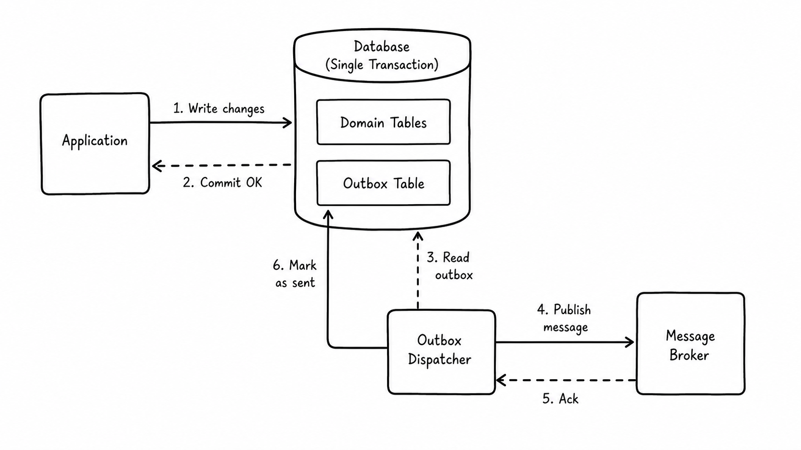

# Persistence and atomic commits

Use this extension point when Kanban state should live in your application's
database.

## Repository boundary

`KanbanRepository` stores immutable `BoardSnapshot` records:

```python
from kanban.spi import BoardSnapshot


class PostgresKanbanRepository:
    def get(self, board_id: str) -> BoardSnapshot | None: ...

    def save(
        self,
        board: BoardSnapshot,
        expected_version: int | None = None,
    ) -> BoardSnapshot: ...

    def delete(self, board_id: str, expected_version: int) -> None: ...

    def list_all(self) -> list[BoardSnapshot]: ...

    def exists(self, board_id: str) -> bool: ...
```

Treat `BoardSnapshot` as an opaque persistence record. Infrastructure does not
receive mutable `Board` objects.

## Optimistic concurrency

`expected_version` protects against lost updates. Raise `ConcurrencyError` when the
stored version differs from the expected version.

## Repository vs unit of work

The simplest distinction is:

> **Repository reads state. Unit of work commits an operation.**

Kanban Core needs the repository separately because read paths such as
`get_board()` and `list_boards()` must load persisted snapshots.

Mutation paths are different. One facade call can produce both:

- a new `BoardSnapshot`;
- one or more business events.

Those should become durable as one operation. `KanbanUnitOfWork` owns that commit
boundary:



A production implementation might therefore look like:

```python
class PostgresKanbanUnitOfWork:
    def save(self, board, events, expected_version=None):
        with database.transaction():
            saved = repository.save(
                board,
                expected_version=expected_version,
            )
            outbox.append(events, aggregate_version=saved.version)
            return saved
```

This is why the facade is given both contracts: the repository supports reads; the
unit of work coordinates commits.

For production, an outbox is preferable to "save, then publish", because a process
failure between those two operations can otherwise leave committed state with a
missing event.

## Composition

```python
kanban = KanbanFacade(
    PostgresKanbanRepository(...),
    PostgresKanbanUnitOfWork(...),
)
```
