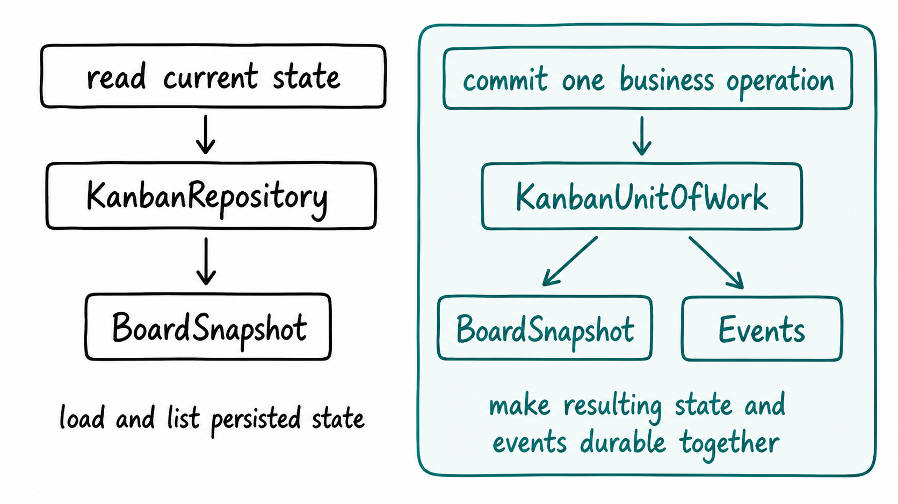

# Quickstart

This guide gets a board running first, then explains the few classes you need to
understand.

## Install

```bash
pip install kanban-core
```

## Compose an in-memory instance

```python
from kanban import KanbanFacade
from kanban_adapters import (
    EventBus,
    InMemoryKanbanRepository,
    SynchronousKanbanUnitOfWork,
)

repository = InMemoryKanbanRepository()
events = EventBus()
uow = SynchronousKanbanUnitOfWork(repository, events)
kanban = KanbanFacade(repository, uow)
```

| Class | Think of it as |
| --- | --- |
| `KanbanFacade` | the business API your application calls |
| `InMemoryKanbanRepository` | a reference persistence adapter |
| `SynchronousKanbanUnitOfWork` | the commit boundary for state and events |
| `EventBus` | a reference event-delivery adapter |

The last three are replaceable infrastructure. `KanbanFacade` is the stable
application entry point.

### Repository vs unit of work

The repository and unit of work are deliberately separate:



The repository is used to load and list Kanban state. The unit of work is used when
a facade operation must make its resulting state and events durable.

For the in-memory implementation that distinction is small. In a production
database implementation, the unit of work can save the snapshot and append the
events to an outbox in the same transaction.

Remember:

> **Repository reads state. Unit of work commits an operation.**

## Create a board

```python
board = kanban.create_board("alice", "Website launch")
todo = board.column_named("To Do")
assert todo is not None
```

`board` is a `BoardView`: an immutable observation of committed state.

## Add and move a card

```python
card = kanban.add_card(
    "alice",
    board.id,
    todo.id,
    "Write release notes",
    description="Summarize the user-visible changes",
)

in_progress = board.column_named("In Progress")
assert in_progress is not None

card = kanban.move_card(
    "alice",
    board.id,
    card.id,
    in_progress.id,
)
```

Columns and cards are identified by IDs, not names.

## Read current state

```python
board = kanban.get_board("alice", board.id)

for column in board.columns:
    print(column.name)
    for card_id in column.card_ids:
        card = board.card(card_id)
        assert card is not None
        print("  ", card.title)
```

Do not mutate `BoardView`, `ColumnView` or `CardView`. To change state, call the
facade again.

## Update, search and delete

```python
kanban.update_card(
    "alice",
    board.id,
    card.id,
    title="Write and publish release notes",
)

matches = kanban.search_cards("alice", board.id, text="release")
kanban.delete_card("alice", board.id, card.id)
```

## The important classes

### `KanbanFacade`

The complete supported business-operation surface.

### `BoardView`, `ColumnView`, `CardView`

Immutable values returned to callers. They describe committed state but cannot
mutate it.

### `KanbanRepository`

The outbound persistence contract used to read and store `BoardSnapshot` records.
It answers questions such as "load this board" and "list the boards".

### `KanbanUnitOfWork`

The commit contract for a business operation. It makes the resulting board state
and events durable together. In production this is typically where a database
transaction and outbox are coordinated.

### Extension ports

Permissions, workflow validation, search and automation are constructor-injected
ports. They receive detached immutable facts rather than the mutable aggregate.

## Next

- [Core concepts](concepts.md)
- [Extending Kanban Core](extensibility.md)
- [Integration patterns](integration-patterns.md)
