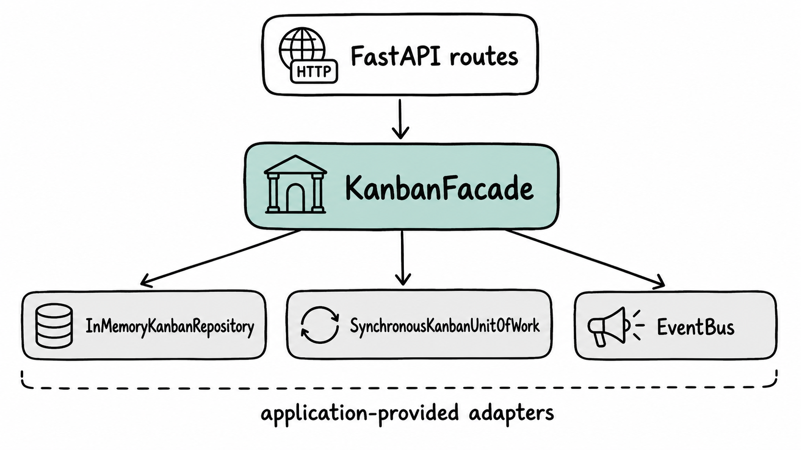

# Kanban Core Demo UI

A small, build-free demo application for `kanban-core`.

It is deliberately **not** part of the business module. The demo uses the same public
composition style as any other application:



The UI contains no copy of Kanban business rules. Dragging a card calls
`KanbanFacade.move_card()`, WIP limits are enforced by Kanban Core, and failures are
shown back to the user.

## What the demo includes

- create and switch boards
- add columns
- set/clear WIP limits
- create, edit and delete cards
- drag cards within and between columns
- block and unblock cards
- recent business-event panel
- native HTML dialogs for editing
- no Node/npm/build step

The frontend uses server-rendered Jinja templates, a small amount of JavaScript,
native HTML drag-and-drop, and HTMX for the live event panel. Dragging updates the
browser optimistically, but the server's facade remains authoritative; failed moves
are restored and shown to the user.

## Install

From the root of a `kanban-core` checkout:

```bash
python -m pip install -e .
python -m pip install -r demo_ui/requirements.txt
```

If you extracted this bundle beside the repository, install Kanban Core first:

```bash
python -m pip install -e /path/to/kanban-core
python -m pip install -r requirements.txt
```

## Run

From the directory containing the `demo_ui` package:

```bash
uvicorn demo_ui.app:app --reload
```

Open:

```text
http://127.0.0.1:8000
```

The app seeds a small "Product launch" board the first time it starts.

## Deliberate limitations

This is a demo, not a reference production web application:

- state is in memory and resets on restart;
- one demo user (`demo-user`) is used for every operation;
- there is no authentication or CSRF protection;
- the event panel is an in-process event history, not a durable outbox;
- CDN-hosted HTMX and SortableJS are used to keep the bundle build-free.

Those limitations keep the UI small while exercising real `kanban-core` behavior.
